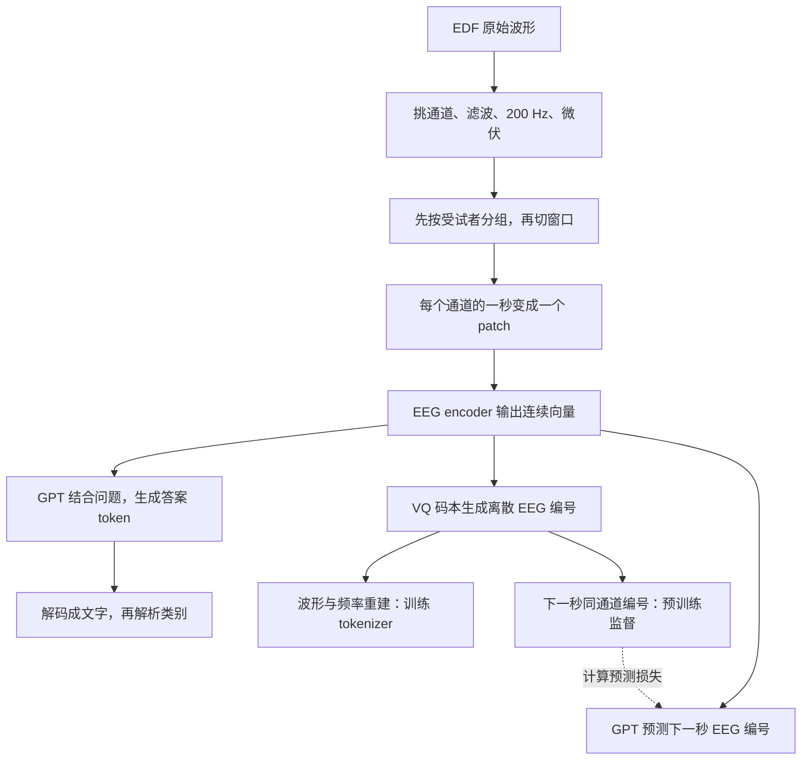

# 从一段脑电到一个回答：NeuroLM 入门实验

本实验的目标是亲眼看到完整的数据流：EDF → 预处理 → 切窗 → 数字张量 → EEG encoder → GPT → 输出与损失 → 参数更新 → 留出数据上的输出。代码使用仓库真实模型模块与作者 NeuroLM-B 权重。每阶段只更新 16 次，目的是理解流程，不能作为论文复现或可靠效果评价。



## 先认清几个词

- **通道**：一个电极导联记录的波形。19 通道就是同时有 19 条波形，不是 19 个受试者。
- **采样率**：每秒记录多少个数。200 Hz 就是每秒 200 个数。
- **窗口 / 样本**：从长记录中取的一小段。Workload 一个窗口长 4 秒。
- **张量与形状**：张量就是带维度的数字数组。`[2,76,200]` 表示一批 2 个样本，每个样本 76 个小片段，每个片段 200 个数。
- **patch**：本代码中一个通道的一秒波形。因此一个 19 通道、4 秒窗口有 `19×4=76` 个 patch。
- **token**：序列中的一个位置。文字 token 是分词器得到的编号；EEG encoder 的输入位置对应一个 patch，其输出是一个连续向量。
- **权重**：模型通过训练改变的数；**损失**是预测错得多少；**梯度**告诉优化器怎样改变权重。
- **前向**：输入走过模型得到输出。**反向**：根据损失计算梯度。**更新一次**：优化器根据梯度改变权重。
- **训练集**用来更新权重；**验证集**用于开发检查；**测试集**用于固定流程后的评估。相邻重叠窗口必须留在同一受试者所属的集合中。

## 1. 原始文件到底是什么

数据位置在项目 `data/raw/`。下载与原始 EDF 文件头已核查，文件清单在 `data/download_manifest.json`。

| 来源 | 原始 EEG | 训练 / 验证 / 测试受试者 | 窗口 |
| --- | --- | --- | --- |
| Workload | 19 EEG 通道，500 Hz；文件还有参考、ECG、标注 | 00–25 / 26–30 / 31–35 | 末尾 60 秒，4 秒窗，2 秒步长 |
| HMC | 4 EEG 导联，256 Hz；文件还有眼电、肌电和心电 | SN001 / SN103 / SN128 | 按评分对齐的 30 秒窗 |
| MotorImagery | 64 EEG 通道，160 Hz；另有标注 | S001 / S002 / S003 | 不重叠 16 秒窗，尾部不足部分丢弃 |

Workload 的 `_1` 文件表示静息（标签 0），`_2` 表示心算（标签 1）。HMC 的标签是人工睡眠评分：W=0、N1=1、N2=2、N3=3、REM=4；Lights off/on 是开关灯标记，不能当成睡眠类别。运动想象这里只作为无标签预训练波形来源，不把 T0/T1/T2 事件混入下游指令任务。

## 2. EDF 怎样变成一个训练样本

实现入口：`dataset_maker/prepare_learning_data.py`；运行入口：`scripts/learning_prepare.sbatch`。全过程在计算节点执行。

1. `mne.io.read_raw_edf` 读取文件，先记录原始通道名、采样率和长度。
2. 挑选 EEG 导联。Workload 去掉参考与 ECG，按固定的 19 通道顺序排列。HMC 只保留 F4-M1、C4-M1、O2-M1、C3-M2；这里只规范名字，没有改变导联的原始参考方式。
3. 做 0.1–75 Hz 带通滤波，抑制频带以外的变化。再做电网频率陷波：Workload/HMC 为 50 Hz，运动想象为 60 Hz。原始数据中已经移除的信息不会因此恢复。
4. 真正重采样到 200 Hz。这会改变波形的时间点数量，不是只把文件头的数字改为 200。
5. 通过 `get_data(units='uV')` 把单位明确设成微伏，转成 float32，检查没有 NaN 或无穷值。
6. 按上表切窗。HMC 用整数采样点边界 `[start,start+6000)` 切片，检查不越界；这样不需要在最后一个窗口的结束时刻去查一个不存在的时间点。
7. 每个窗口写成一个 `.pkl`，还记录来源文件和起始秒数，便于追溯。

```python
{
    'X': ... ,              # [通道数, 采样点数]，float32，单位 µV
    'ch_names': ... ,       # 与 X 行顺序完全一致的电极名
    'y': ... ,              # 仅下游任务有类别标签
    'source': ... ,         # 来自哪条 EDF
    'start_seconds': ... ,  # 在这条 EDF 中从哪里开始
}
```

| 输出样本 | X 的形状 | 样本数 train / eval(val) / test |
| --- | --- | --- |
| Workload | `[19,800]` | 1508 / 290 / 290 |
| HMC | `[4,6000]` | 854 / 984 / 926 |
| MotorImagery | `[64,3200]` | 13 / 13 / 13 |

每个原始文件的前后形状、滤波参数、数值范围，以及每组类别数量，保存在 `data/processed/preprocessing_trace.json`。这些数量是实际运行后的检查结果。

## 3. 第一阶段：Workload 的数据如何进入模型

训练入口是 `scripts/learning_pipeline.py` 的 `instruction`，复用 `downstream_dataset.py` 的 `WorkloadLoader`。

1. 从训练受试者的 `.pkl` 读取 `[19,800]`。
2. 除以 100，把微伏数值缩放到较适合神经网络的量级。这里不是对每个窗口重新算均值和方差。
3. 每通道按 200 个点拆成 4 段，然后按“第 0 秒的所有通道 → 第 1 秒的所有通道……”排列，得到 `[76,200]`。
4. 生成 `input_chans`：告诉模型每个位置属于哪个电极。生成 `input_time`：告诉模型它属于第几秒。同一秒的 19 个通道有相同时间编号。
5. 为了与 HMC 混合成批次，EEG 补零到 `[276,200]`。Workload 的前 76 个位置有效，后 200 个位置是占位。`input_mask` 标出这些位置，防止把占位当成真实 EEG。
6. 文字分词器把问题与答案转成整数。训练文本形如 `Question: Is this EEG segment of high workload? Answer: Yes <|endoftext|>`。特殊编号 50257 用来表示 EEG 和文字的分界，文字补到 80 个位置。
7. `Y_text` 初始全是 -1，只有应该预测答案的位置填入下一个文字 token。-1 的含义是“不计入损失”，因此模型不会因为复述问题而获得答案训练分数。
8. 构造注意力矩阵。一个 EEG patch 可以看见同一秒所有通道与过去各秒；文字位置可以看见有效 EEG 和先前文字，不能偷看未来答案。
9. 两个样本堆成 batch，EEG 是 `[2,276,200]`，文字是 `[2,80]`。首批输入保存成 `data/runs/learning/workload-first-batch.pt`，JSON 记录每个数组的形状、类型及前几个真实值。

## 4. 模型内部：波形怎样变成语言输出

实现入口：`model/model_neural_transformer.py`、`model/model_neurolm.py`、`model/model.py`。

1. **patch 内卷积**：每个 200 点波形独立经过三层卷积，第一层把时间长度缩为 25；16 个特征通道展开成 `25×16=400`，再投影到 768 维。因此 EEG 由 `[2,276,200]` 变成 `[2,276,768]`。
2. **EEG encoder**：加上电极与秒编号的可学习向量，经过 Transformer，让不同通道、不同秒相互交换信息。仍然输出 `[2,276,768]`，没有把整个样本压成一个类别。本次下游运行中 encoder 冻结，不参与权重更新。
3. **送入 GPT**：使用 encoder 的连续 768 维向量，加 GPT 侧的电极与时间信息。这里没有先把 EEG 换成离散编号再查文字词表。
4. **拼接文字**：文字编号查 embedding 表后也得到 768 维向量，与 EEG 序列拼接，训练序列共 `276+80=356` 个位置。
5. **GPT Transformer**：在掩码允许的范围内，把 EEG 信息与问题上下文整合起来。
6. **输出头**：每个被计算的位置产生 58,496 个 logits（未归一化分数）。前 50,304 是文字区域及保留位置，后 8,192 是 EEG 码本区域；训练时完整输出形状是 `[2,356,58496]`。
7. **答案损失**：监督只保留答案，EEG 前缀目标被设成忽略值。把正确 token 的得分与其他 token 的得分比较得到交叉熵损失。
8. **参数更新**：`backward()` 算梯度，梯度范数裁剪到 1，再由 AdamW 更新未冻结权重。记录每一步损失和裁剪前梯度范数。当前学习率是 1e-5，批大小 2，共 16 步；不是原论文的完整训练配置。

训练时已经给出了正确答案，模型学的是“下一步该写哪个 token”。**推理时不给真实答案**：验证加载器只提供问题，模型预测一个 token，把它接回输入，再预测下一个。本次固定贪心选择（top_k=1），最多生成 5 个 token，保存完整生成编号、解码字符串、解析出的类别与真实标签。

## 5. 第二阶段：加入 HMC 后改变了什么

HMC 的 `[4,6000]` 同样拆成一秒 patch，得到 `[120,200]`，补到 `[276,200]`；120 个有效位置对应 4 导联、30 秒。问题改为五选一睡眠阶段，答案是 A/B/C/D/E。其余卷积、encoder、GPT、词表和损失路径共享。

本次两个任务轮流各训练一个 batch，总共 16 步，即各 8 步。两项教学实验都从同一份作者 checkpoint 重新初始化，方便看清任务组织；不是把单任务的 16 步继续追加成多任务。任务采样也不同于原脚本把所有窗口拼在一起随机抽取，因此这里不用于宣称多任务优于单任务。

实际排查发现原 `HMCLoader` 把答案监督提前了一格：问题已经结束于 `Answer: (`，正确的下一个目标应为 `A` 等字母，原代码却先要求预测 ` (`。已修正这一个偏移，并添加 `scripts/check_instruction_targets.py`，逐类检查“推理问题确实是训练文本的前缀，受监督 token 恰好是问题之后的答案”。这是代码正确性问题，应先修复，而不能靠增加训练轮数掩盖。每个任务首批追踪都保留原 EDF 文件名、切窗起点、有效 patch 数及实际监督答案；每次更新记录使用的窗口文件名。

每个任务的验证和测试固定取各类别最早的两个窗口，选择规则不看模型预测。Workload 每组只看 4 个窗口，HMC 每组只看 10 个窗口。输出报告给出准确率与无法解析的回答数，但这只是检查推理与解析是否走通；窗口少、同一受试者内相关，不能当作稳定泛化指标。作者 checkpoint 的历史数据访问也不由本次实验重新保证。

## 6. 第三阶段之一：训练 EEG tokenizer

这一步使用 S001 的 13 个运动想象窗口。一个输入 `[64,3200]` 拆成 `[1024,200]`，刚好占满 1024 个 patch，不需要 padding。`dataset.py` 的 `PickleLoader` 还生成两种重建目标：标准化波形 `[1024,200]` 与 FFT 幅度的前一半 `[1024,100]`。

1. EEG encoder 输出每个 patch 的 768 维连续表示。
2. 投影网络把它变成 128 维，L2 归一化后与 8,192 个码本向量比较距离，为每个 patch 选一个离散编号（0–8191）。
3. 量化向量分别进入波形 decoder 和频率 decoder，预测原始目标。重建损失衡量它们相差多大；量化损失约束 encoder 表示靠近选中的码本向量。
4. 码本向量用指数移动平均更新，梯度通过 straight-through 路径回传给 encoder；离散的“选第几个编号”本身不能直接求导。
5. 域分类器尝试区分 EEG 向量和文字向量，梯度反转让 EEG encoder 朝更难区分的方向更新。这是分布对齐，不是学到每段 EEG 对应一句自然语言。
6. 本次 EEG tokenizer 从随机权重训练 16 步，文字 embedding 复用作者 checkpoint 并冻结。这样无需另下载一整套 GPT-2。`VQ_Align` 新增可选 embedding 输入，默认行为仍然加载原始 GPT-2。
7. 为控制学习成本，文字只用脚本中明示的一段通用英文，保存在 `text_source.json`，没有使用 OpenWebText，不能视为复现原论文的语言训练。

重建、量化、两个域分类损失都会记录。保存的 `tokenizer.pt` 包含 encoder、码本、decoder 与域分类器权重，供下一阶段使用。

## 7. 第三阶段之二：多通道自回归预训练

1. 冻结刚训练的完整 tokenizer，离散码仅用于生成目标；把同一份 encoder 权重装入 NeuroLM 的冻结 EEG encoder，连续表示仍然用作 GPT 输入。
2. GPT 其他参数从作者 checkpoint 开始。本次是用少量数据练习继续训练，不是从头重建论文 25,000 小时预训练。
3. 设 0 秒的 64 个 patch 的编号为 `z[0:64]`，1 秒的为 `z[64:128]`。输入第 0 秒的 64 个位置时，目标是第 1 秒同样 64 个通道的编号。因此监督向前移动 **64 个位置**，不是一个位置。
4. 把 EEG 类别编号加上 50,304，落到合并输出词表的 EEG 区域。没有下一秒可预测的最后 64 个位置，目标设为 -1，忽略其损失。1024 个输入位置中有 960 个受到下一秒监督。
5. 同一秒各通道相互可见，未来秒不可见；另外使用小段英文计算文字下一 token 损失，两种损失相加，反向更新 GPT。
6. 16 次更新后，取未参与更新的 S002 的一个窗口检查 EEG 损失，保存前八个真实目标编号与预测编号。这里输出是下一秒 EEG 的类别分数，不是 Yes/No 或睡眠阶段。

## 8. 到哪里看实际数值，怎样重跑

先阅读同目录的 `learning_run_results.md`（运行完成后由报告脚本生成），再按里面的文件名定位证据。运行数据保留在 `data/runs/learning/`：

| 文件 | 解决的问题 |
| --- | --- |
| `environment.json` | 哪个 Git 提交、GPU、PyTorch、随机种子和模型配置？ |
| `workload.json` | 单任务输入、每层输出、监督位置、损失和实际文字回答？ |
| `multitask.json` | 两个任务怎样交替训练，各自输出什么？ |
| `tokenizer.json` | 波形怎样变成连续向量、离散码、两个重建结果？ |
| `autoregression.json` | 编号怎样移动一个完整时间步，GPT 预测了什么？ |
| `tokenizer_inspection.json` | 加载训练后的 tokenizer，在 S002 上重建出的波形与频率具体是多少？ |
| `text_source.json` | 这次究竟用了什么文字数据？ |
| `*-first-batch.pt` | 想逐元素查看首批模型输入时读取什么？ |
| `*.pt` | 各阶段实际保存的模型权重；不提交到 Git |

```bash
cd /home_data/home/v-niuzhk/project/NeuroLM
sbatch scripts/learning_prepare.sbatch
# 确认预处理成功、模型下载与校验成功之后再提交
sbatch scripts/learning_run.sbatch
# 四阶段作业成功后，加载 tokenizer 做一次零更新重建检查
sbatch scripts/learning_run.sbatch --inspect-tokenizer
# 上一作业成功后，把实测 JSON 生成为可纳入 Git 的 Markdown
/home_data/home/v-niuzhk/anaconda3/bin/python scripts/render_learning_report.py
```

Git 分支是 `codex/learning-pipeline`。`origin` 指向用户 fork `fanniuzhan/NeuroLM`，`upstream` 指向作者仓库。代码、讲解与小型结果摘要提交到 Git；EDF、切片、缓存与大权重由下载清单和日志追踪，避免进入 Git。
