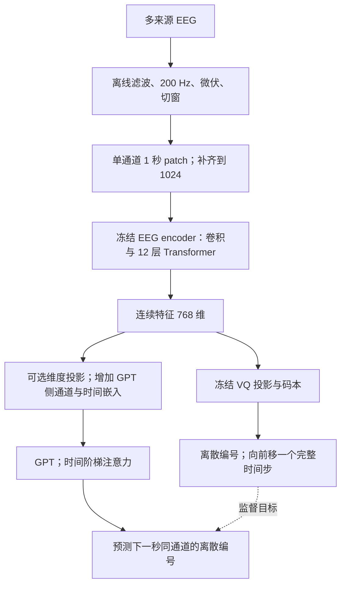

# NeuroLM 预训练数据输入与架构核查

核查日期：2026-11-16。源码版本：官方仓库 `935963004/NeuroLM`，提交 `0cda9876d8ce6ee07ed0c43eee5e9a6f5c24b177`（2025-09-19）。论文阅读范围：arXiv v3 的方法、实验设置、附录 C/D；以下涉及实现的结论以本次新克隆源码为准。

**核心结论：统一的是每个样本的 patch 数上限与每个 patch 的表示，不是所有数据集的通道数或固定秒数。** 每个 patch 对应一个通道的 1 秒信号，经过共享卷积和 Transformer 得到特征。GPT 接收冻结 encoder 的连续特征，而离散码本编号用于下一时间步预测的监督。

## 1. 本次仓库重置

- 已从 <https://github.com/935963004/NeuroLM.git> 新克隆官方仓库，替换原项目根目录内容。
- 已删除原 `code/` 子模块、旧外层 Git 仓库、旧 `.gitmodules` 及原项目其他可清理内容。现在源码直接位于 `/home_data/home/v-niuzhk/project/NeuroLM/`。
- 保留环境管理的 `.agents/`、`.codex/`、`.aws/`；未读取其内容。
- 安装后逐文件比对了官方仓库的 37 个受版本管理文件，内容全部一致；`git fsck` 通过。本文件是另行新增的调研记录，没有修改官方源码。
- 本次没有下载 EEG 数据、运行数据处理或训练，也没有检查实际 checkpoint 的内部配置。后文是论文和源码核查及静态推导。

## 2. 预训练数据有哪些

论文附录 C 表 6 汇总了以下来源。通道数、采样率是该表报告的原始配置，不是统一预处理后的配置。

| 来源 | 原始通道数 | 原始采样率 Hz | 时长 h |
| --- | ---: | ---: | ---: |
| TUEG | 17–23 | 250–1024 | 约 24,000 |
| SEED Series：IV / V / GER / FRA | 62 | 1000 | 170.54 |
| BCI Competition IV-1 | 59 | 1000 | 8.21 |
| Emobrain | 64 | 1024 | 4.94 |
| Grasp and Lift | 32 | 500 | 11.72 |
| Inria BCI | 56 | 600 | 29.98 |
| Motor Movement/Imagery | 64 | 160 | 47.3 |
| Raw EEG Data | 64 | 256 | 34.35 |
| Resting State | 64 | 256 | 3.04 |
| Siena Scalp EEG | 31 | 512 | 30.47 |
| SPIS Resting State | 64 | 2048 | 0.83 |
| Target Versus Non-Target | 32 | 512 | 16 |
| 作者自采 EEG 集合 | 62 | 1000 | 342.23 |

论文报告清理后总量接近 25,000 小时，主体来自 TUEG。表中也包含作者自采数据，因此不能把整套语料都视为已经公开可下载。

来源：[论文附录 C](https://arxiv.org/html/2409.00101v3#A3)。公开仓库没有提供这 13 类来源各自完整的预训练转换脚本、数据清单和实际样本统计；不能仅凭论文表格重建全部训练语料。

## 3. 不同配置怎样统一

### 3.1 离线预处理先统一信号尺度

官方 README 与 TUH 示例的共同要求：保留需要的 EEG 通道，带通 0.1–75 Hz，按电网频率做 50/60 Hz 陷波，重采样至 200 Hz，输出单位为微伏。加载样本时再除以 100。

TUH 示例的具体实现还有以下细节：

- 固定使用 60 Hz 陷波。
- 检查第一个通道名的参考后缀；若为 `LE`，跳过整个文件。
- 依据允许的通道名列表过滤通道，删除通道名前后缀，如 `EEG FP1-REF` 变成 `FP1`。
- 去掉每条记录最后 10 秒，再切分为不重叠窗口；不足一个窗口的尾部丢弃。
- 没有执行通用的重参考操作，也没有将各来源插值成同一电极布局。

因此，**通道名归一不等于参考方式归一**。不同参考方式、设备与人群的差异仍可能存在。其他数据集的实际参考处理需要各自脚本或原始数据说明才能确认。

每个 `.pkl` 保存一个样本，至少包含：

```python
{"X": signal, "ch_names": channel_names}
# signal: [C, 200 * D]，单位 µV
# C 为保留通道数，D 为整数秒
```

依据：[TUH 预处理](/home_data/home/v-niuzhk/project/NeuroLM/dataset_maker/prepare_TUH_pretrain.py:43)、[样本保存](/home_data/home/v-niuzhk/project/NeuroLM/dataset_maker/prepare_TUH_pretrain.py:69)、[统一加载](/home_data/home/v-niuzhk/project/NeuroLM/dataset.py:54)。

### 3.2 epoch duration：单样本窗口和训练轮数要分开

如果 epoch duration 指 EEG 切片的时长，TUH 预训练示例使用：

```python
time_length = (1024 // len(chOrder)) * 200  # 时间轴上的采样点数
```

所以：

\[
D=\left\lfloor\frac{1024}{C}\right\rfloor\text{ 秒},\qquad
N_{\rm patch}=C D\leq1024.
\]

| 保留通道数 C | 按示例公式计算的窗口 D | 有效 patch 数 | 补零 patch 数 |
| --- | ---: | ---: | ---: |
| 17 | 60 秒 | 1020 | 4 |
| 19 | 53 秒 | 1007 | 17 |
| 21 | 48 秒 | 1008 | 16 |
| 23 | 44 秒 | 1012 | 12 |
| 31 | 33 秒 | 1023 | 1 |
| 32 | 32 秒 | 1024 | 0 |
| 56 | 18 秒 | 1008 | 16 |
| 59 | 17 秒 | 1003 | 21 |
| 62 | 16 秒 | 992 | 32 |
| 64 | 16 秒 | 1024 | 0 |

**这张表是公式计算结果。源码直接确认的是 TUH 示例；其余通道配置若采用同一公式会得到相应时长，但公开材料不足以确认各来源实际都这样切片。** `PickleLoader` 也可以接收更短的整数秒样本，只要不超过 patch 和时间嵌入的限制。

如果 epoch 指完整遍历训练集的轮数，`train_vq.py` 默认训练 tokenizer 50 轮，`train_pretrain.py` 默认训练 GPT 20 轮。单轮实际耗时未在本次测量，不能由这两个数推算。

| 阶段 | 默认训练轮数 | 每卡 EEG batch | 每卡文字 batch | 8 卡下 EEG / 文字 batch |
| --- | ---: | ---: | ---: | --- |
| tokenizer | 50 | 64 | 16 | 512 / 128 |
| GPT 预训练 | 20 | 60 | 4 | 480 / 32 |

最后一列按 8 卡、默认梯度累积为 1 计算；不是本次实际启动的训练配置。

依据：[窗口公式](/home_data/home/v-niuzhk/project/NeuroLM/dataset_maker/prepare_TUH_pretrain.py:79)、[tokenizer 训练参数](/home_data/home/v-niuzhk/project/NeuroLM/train_vq.py:305)、[GPT 训练参数](/home_data/home/v-niuzhk/project/NeuroLM/train_pretrain.py:419)。

### 3.3 统一成 [1024, 200]，保留通道身份

加载器将 `[C, D*200]` 变换为 `[D*C, 200]`，按时间优先排列：

```text
t=0: channel_1, channel_2, ..., channel_C
t=1: channel_1, channel_2, ..., channel_C
...
```

不足 1024 个 patch 时，在序列末尾补零；没有把缺失电极补成某个固定的全通道 EEG 矩阵。

| 张量 | 单样本形状 | 含义 |
| --- | --- | --- |
| X | [1024, 200] | 每行是一个通道的 1 秒波形 |
| input_chans | [1024] | 每个 patch 的电极名称在共享词表中的编号 |
| input_time | [1024] | 相对秒编号，同一秒所有通道编号相同 |
| input_mask | [1024] | 哪些位置是真实 patch |
| gpt_mask | [1, 1024, 1024] | GPT 阶段的时间阶梯掩码 |

batch 维度加入后，EEG 输入就是 `[B,1024,200]`，不同来源可以放在同一 batch 中。

通道名称通过 `standard_1020.index(ch_name)` 查编号。encoder 学习通道嵌入和时间嵌入，因而同一个电极在不同来源中可共享表示。这里是电极身份查表，不是显式的三维头皮坐标建模；词表也未自动合并所有电极别名。未知名称会报错。

加载器中 `sampling_rate` 参数没有驱动重采样；切 patch 的实现直接写死 200。必须在离线阶段真正完成重采样，不能只修改参数。

依据：[数据变换与元信息](/home_data/home/v-niuzhk/project/NeuroLM/dataset.py:60)、[通道词表](/home_data/home/v-niuzhk/project/NeuroLM/dataset.py:12)。

### 3.4 多来源怎样混合

`train_vq.py` 和 `train_pretrain.py` 都递归收集 `dataset_dir/train` 下的 `.pkl`，形成一个文件列表，使用同一个 `PickleLoader`。GPT 预训练还读取 `dataset_dir/val`。

单卡随机打乱；多卡使用 `DistributedSampler`。没有发现按数据集身份设置均衡采样或数据集专用 encoder。原始记录先离线切片，训练时按文件读取，不是每次随机从长记录裁剪。

由此可推得：各来源被抽中的比例主要取决于产生多少个 `.pkl`。若都按上述公式切满窗口，同等记录时长下，高通道数会产生更多样本。因此混合权重并不简单等于各来源的小时数占比。这是从加载策略和切片公式得到的推论，未核查实际训练清单。

TUH 示例没有实现预训练 `train/val` 划分。后续复现应先按独立受试者或记录确定划分，再切窗，避免相邻片段跨集合；不能把已有目录名视作独立性已得到保证。

依据：[GPT 数据收集与采样](/home_data/home/v-niuzhk/project/NeuroLM/train_pretrain.py:92)、[tokenizer 数据收集](/home_data/home/v-niuzhk/project/NeuroLM/train_vq.py:89)。

## 4. EEG encoder 怎样设计

这里有两个 Transformer：前面的 EEG encoder 和后面的 GPT。两者负责不同的表示层次。

### 4.1 patch 内的时域卷积

`TemporalConv` 接收 `[B,1024,200]`，增加一维后使用三个 `Conv2d`；卷积核高度都是 1，所以卷积核只沿每个 patch 内部的时间轴移动：

| 层 | 特征通道变化 | 卷积核 | 步长 | padding |
| --- | --- | --- | --- | --- |
| Conv 1 | 1 → 16 | (1,15) | (1,8) | (0,7) |
| Conv 2 | 16 → 16 | (1,3) | (1,1) | (0,1) |
| Conv 3 | 16 → 16 | (1,3) | (1,1) | (0,1) |

每层配有 GroupNorm 和 GELU。这里的 16 是卷积特征通道数，不是 EEG 电极数。

200 个时间点经第一层变成 25 个位置，后两层保持长度；将 `25*16=400` 个值展平，再经 `Linear(400,768)+GELU`，每个 patch 得到 768 维向量。

依据：[TemporalConv](/home_data/home/v-niuzhk/project/NeuroLM/model/model_neural_transformer.py:13)。

### 4.2 patch 间的时空 Transformer

每个向量加上学习得到的电极嵌入和相对秒嵌入，再送入 12 层 Transformer。实际训练配置为隐藏维度 768、12 个注意力头、MLP 维度 3072。输出保留每个 patch 的特征，即 `[B,1024,768]`，没有在这条路径上池化成一个样本向量。

注意力联合处理不同通道、不同秒的 patch，不是给每个数据集或电极单独训练一个 encoder。类名中的 spatial encoder 也不代表只做同一时刻的空间注意力。

源码中 `NTConfig` 类的缺省值包含 `n_embd=400`、`n_head=10`，但训练脚本明确覆盖成 768/12；不能只读 dataclass 默认值判断实际配置。

依据：[NeuralTransformer](/home_data/home/v-niuzhk/project/NeuroLM/model/model_neural_transformer.py:63)、[训练时配置](/home_data/home/v-niuzhk/project/NeuroLM/train_vq.py:122)。

## 5. 第一阶段：训练有语言空间对齐的 tokenizer

encoder 的 768 维特征，经 `768 → 768 → 128` 投影后做向量量化。码本包含 8192 个 128 维向量，使用 L2 归一化后的最近邻选择，并通过 EMA 更新码本。于是每个有效 patch 对应一个 0–8191 的离散编号。

量化特征分别进入两个重建分支：

- 时域分支：预测 patch 的 200 个标准化波形值。
- 频域分支：预测 FFT 幅度的前 100 个频点。幅度先在样本的有效 patch 与频点上做标准化，再截取前半；它不是完整的时频图，也不预测相位。

另一个域分类器接收 EEG encoder 的 768 维特征，以及冻结 GPT-2 词嵌入得到的文字特征。梯度反转让 EEG encoder 学到较难与文字区分的特征分布；文字和 EEG 不需要逐样本配对。

这属于分布层面的对齐，不能直接解释为某段 EEG 已对应某句自然语言含义。当前训练脚本使用 OpenWebText 的 token batch 提供文字输入。

两项需要保留的实现边界：

1. 论文附录 D 表 7 写 decoder 为 3 层，本次源码 `train_vq.py` 实际新建两个 4 层 decoder。恢复 checkpoint 时会读取保存的参数，具体权重以 checkpoint 为准。
2. padding 在注意力的 key、重建输出和域分类损失中有掩码处理；量化器本身没有接收有效位置掩码，因此不能说 padding 已从码本更新和量化损失中完全排除。

依据：[VQ 结构与投影](/home_data/home/v-niuzhk/project/NeuroLM/model/model_vq.py:30)、[编码与重建](/home_data/home/v-niuzhk/project/NeuroLM/model/model_vq.py:112)、[文字对齐](/home_data/home/v-niuzhk/project/NeuroLM/model/model_vq.py:193)、[EMA 量化器](/home_data/home/v-niuzhk/project/NeuroLM/model/norm_ema_quantizer.py:144)、[文字数据准备](/home_data/home/v-niuzhk/project/NeuroLM/text_dataset_maker/prepare.py:19)。

## 6. 第二阶段：连续特征输入 GPT，离散码作目标

这是阅读实现时最需要区分的部分。



`NeuroLM.tokenizer` 实际只装入 `VQ.encoder.*` 的权重，并将其冻结。前向直接调用 `NeuralTransformer` 得到连续特征，没有先取离散编号，再查 GPT 的词嵌入表。

独立的完整 VQ 模型则通过 `get_codebook_indices` 生成监督标签。两条路径使用相应的 encoder 权重，但职责不同：**连续特征用于输入；离散码用于分类目标。**

GPT 侧另加一套电极嵌入，并复用 GPT 的时间位置嵌入；同一秒所有 EEG 通道共享同一个时间编号。模型变体的 GPT 隐藏宽度分别为 768、1024、1600，必要时通过线性层加 GELU 将 encoder 的 768 维输出变换到对应宽度。

输出分类头扩大为 `50304 + 8192 = 58496` 类。EEG 标签偏移 50304，从而与文字类别区分。扩展输出空间不意味着 EEG 输入也必须经文字 embedding 查表。

依据：[encoder 装载与冻结](/home_data/home/v-niuzhk/project/NeuroLM/model/model_neurolm.py:48)、[连续特征前向](/home_data/home/v-niuzhk/project/NeuroLM/model/model_neurolm.py:104)、[GPT 位置嵌入及标签偏移](/home_data/home/v-niuzhk/project/NeuroLM/model/model.py:181)。

### 6.1 怎样预测“下一秒”

对 C 个通道，标签在展平后的序列上移动 C 个位置：

```python
Y_eeg[i, :num_token - num_chan] = codebook_indices[i, num_chan:num_token]
```

所以当前位置 `(通道 c, 秒 t)` 的目标是 `(通道 c, 秒 t+1)`，不是展平列表中紧邻的下一个电极。

GPT 的阶梯注意力允许每个位置看到当前秒全部通道及之前各秒的全部通道，不允许看到未来秒。最后一秒没有下一秒目标，padding 也不参与这项预测损失。训练代码先把无效标签设成 `-1-50304`，GPT 加上类别偏移后恰好得到交叉熵忽略值 `-1`。

每一步还有单独的文字自回归前向，损失为 `EEG loss + text loss`。这里的 EEG 和文字不是配对样本，也不是在预训练阶段必须拼接成同一条序列。用于回答任务问题的 EEG 与文字指令拼接属于后续指令微调阶段。

依据：[目标生成与双模态损失](/home_data/home/v-niuzhk/project/NeuroLM/train_pretrain.py:286)、[阶梯掩码](/home_data/home/v-niuzhk/project/NeuroLM/dataset.py:90)、[GPT 损失](/home_data/home/v-niuzhk/project/NeuroLM/model/model.py:237)。

### 6.2 GPT 的时间掩码不等于全流程严格因果

源码传给前置 EEG encoder 的是 padding 掩码，没有限制未来时间；encoder 可以聚合整个窗口的有效 patch。因此，即使 GPT 不直接关注未来位置，其输入特征仍有通过前置 encoder 混入窗口未来信息的通路。

这是根据掩码传递得到的架构判断，没有做干预实验来量化影响。解释结果时可以称为“对整窗编码后的特征做多通道自回归训练”，不能仅凭 GPT 的阶梯掩码断言实现支持严格在线的原始波形预测。

## 7. 当前实现的适用边界

- 每个样本的时间点数须能被 200 整除，有效 patch 数须不超过 1024。加载器没有自动截断超长样本。
- EEG encoder 的 `time_embed` 只有 64 个位置，即相对秒编号应为 0–63。低通道数输入还受这个额外限制：例如 4 通道按 `1024//4` 推出 256 秒，但当前 encoder 无法直接接受如此长的时间编号。HMC 脚本的 30 秒睡眠切片属于另一种任务窗口。
- 更高通道数意味着同一 patch 预算下更短的时间上下文。该方法统一输入格式，没有消除不同配置在可见时间跨度上的差异。
- 通道名、参考方式与单位必须在数据端正确处理。共享 encoder 本身不能保证这些数据语义已一致。
- 公开材料不能确认全部预训练来源的实际切片策略、最终通道集合、训练/验证清单、来源混合比例，或作者自采数据的可获取性。

依据：[时间嵌入容量](/home_data/home/v-niuzhk/project/NeuroLM/model/model_neural_transformer.py:74)、[HMC 30 秒切片](/home_data/home/v-niuzhk/project/NeuroLM/dataset_maker/prepare_HMC.py:17)。

## 8. 本次验证与后续复现入口

已完成官方源码完整性检查、37 个版本管理文件逐字节比对、相关 Python 文件的语法树解析，以及窗口和张量尺寸的静态计算。这些检查不等同于模型训练或数值运行验证。

最小的数据核验应先确定每个来源的 `采样率、单位、参考方式、通道名、C、D、C*D、独立受试者/记录标识`，再检查转换后的样本与独立划分。需要执行实际滤波、批量转换或模型验证时，通过 `sbatch` 提交到计算节点；原仓库预处理脚本包含作者路径和多进程设置，不能直接在登录节点启动。

外部依据：[官方源码固定版本](https://github.com/935963004/NeuroLM/tree/0cda9876d8ce6ee07ed0c43eee5e9a6f5c24b177)、[论文方法与附录](https://arxiv.org/html/2409.00101v3)。
